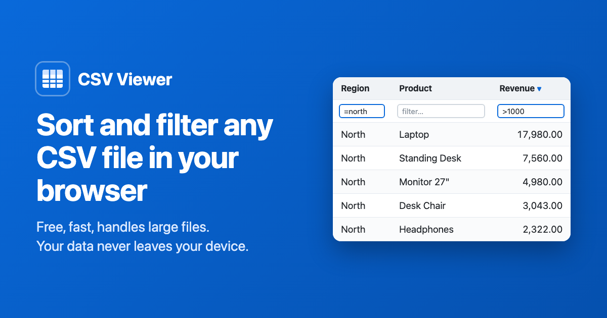

# CSV Viewer

**Open, sort and filter CSV files right in your browser. Free, fast and private.**

👉 **Try it: [atulkumar94.github.io/csv-viewer](https://atulkumar94.github.io/csv-viewer/)**

Your file never leaves your device. It is read and processed entirely inside your browser and is never
uploaded anywhere.

## Features

- **Open any CSV file:** choose a file or drag and drop it. Comma, semicolon, tab and pipe separators are
  detected automatically.
- **Sort by any column:** click a column name to sort ascending, descending, or back to the original order.
  Sort by several columns at once with Shift+click or the *Sort by several columns* checkbox.
- **Filter by any column:** type in the box under a column name. Number and date columns support comparisons
  and ranges such as `>100` or `2025-01-01..2025-03-31`.
- **Search everything:** one search box looks across all columns.
- **Smart sorting:** numbers and dates sort by value, not alphabetically, and blank cells always sort last.
- **Large files:** files with millions of rows load without freezing the page.
- **Export:** download just the rows you filtered, in the order you sorted them, as a new CSV file.
- **Works on phones**, and follows your system's light or dark mode.

## How to use it

1. Go to **[atulkumar94.github.io/csv-viewer](https://atulkumar94.github.io/csv-viewer/)**.
2. Choose a CSV file, or click **Try it with sample data**.
3. Click a column name to sort, or type in the box under it to filter.
4. Click **Export view** to download the result.

## Filter syntax

| Type this | To find |
|---|---|
| `abc` | values containing "abc" |
| `=abc` | values exactly equal to "abc" |
| `!abc` | values not containing "abc" |
| `^abc` / `abc$` | values starting / ending with "abc" |
| `>10` `>=10` `<5` `<=5` | numbers or dates above or below a value |
| `=3` / `!=0` | numbers or dates equal / not equal to a value |
| `10..20` | a range, including both ends, e.g. `2025-01-01..2025-03-31` |
| `(empty)` / `!(empty)` | blank / non-blank cells |
| `>0 & <100` | rows matching every condition |
| `North \| South` | rows matching any condition |

Filters ignore upper and lower case. Columns marked **#** hold numbers and columns marked **date** hold dates.

## Privacy

- Files are processed on your device and are never uploaded.
- The page's security settings block it from making any network requests, so your data can't be sent anywhere.
- No cookies, analytics, ads or third-party scripts.

Read the full [privacy policy](https://atulkumar94.github.io/csv-viewer/privacy.html).

## Limits

- The first row of the file is used as the column names.
- Files must be UTF-8 encoded, the default for most software today. Some older Excel exports use other
  encodings and may show garbled accented characters.
- The largest file you can open depends on your device's memory: usually several hundred megabytes on a
  laptop or desktop, less on phones and tablets.

## Run it on your own computer

No installation or internet connection is needed. Download this repository (**Code → Download ZIP**), unzip
it and open `index.html` in your browser.

## Feedback and bug reports

Found a bug or have an idea? [Open an issue](https://github.com/atulkumar94/csv-viewer/issues) or
[start a discussion](https://github.com/atulkumar94/csv-viewer/discussions). Issues and discussions are
public, so please don't include personal information or the contents of your files.
